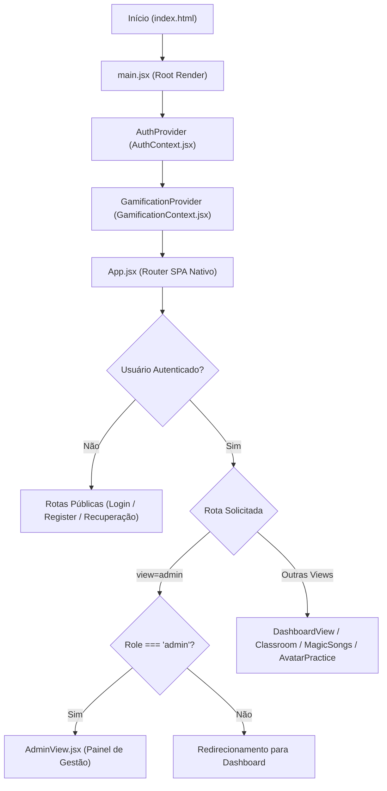
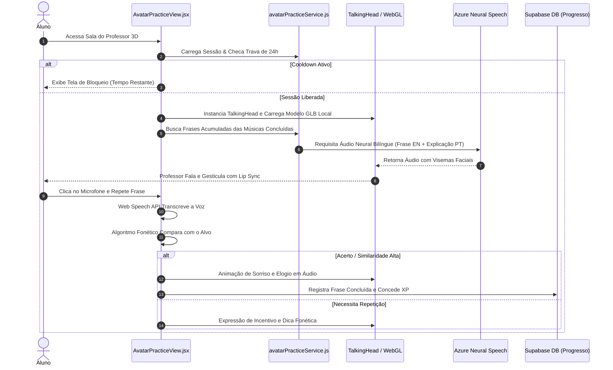

# MAPA TÉCNICO, FLUXOS E ÁRVORE DE COMPONENTES
**Documento 06: Diagramas de Arquitetura, Ciclo de Vida de Estados e Fluxos de Dados**
**Data da Auditoria:** 11 de Outubro de 2026  
**Classificação:** Somente Leitura (Read-Only Audit)

---

## 1. FLUXO GERAL DE INICIALIZAÇÃO E ROTEAMENTO



---

## 2. FLUXO DO CICLO DE PRÁTICA 3D COM AVATAR (LISTEN & REPEAT)



---

## 3. ÁRVORE PRINCIPAL DE COMPONENTES E ESTADOS

```
App.jsx (Estado: currentView, currentModule, currentLesson, currentSong)
│
├── Layout Base
│   ├── Sidebar.jsx (Navegação principal, itens liberados conforme nível)
│   ├── Topbar.jsx (Avatar do usuário, notificações, saldo de XP)
│   └── RightPanel.jsx (Calendário semanal de estudos, ranking rápido)
│
├── Visões do Estudante
│   ├── DashboardView.jsx
│   │   ├── ContinueLearningCard.jsx (Retorno rápido à última aula)
│   │   ├── DashboardFocusCards.jsx (Atalhos principais)
│   │   └── QuickStats.jsx (Minutos estudados, streak)
│   ├── MagicClassroomView.jsx
│   │   ├── VideoPlayer.jsx (YouTube / Google Drive / HTML5)
│   │   ├── LessonTabs.jsx (Overview, Vocabulary, Quiz, Materials)
│   │   └── CompleteLessonButton.jsx (Dispara grant_xp)
│   ├── MagicSongsSection.jsx
│   │   ├── AudioPlayer.jsx (Play, pause, velocidade 0.75x a 1.25x)
│   │   └── SyncedLyrics.jsx (Karaokê linha a linha com tradução)
│   ├── AvatarPracticeView.jsx
│   │   ├── Canvas3DContainer (TalkingHead WebGL)
│   │   ├── TeacherSelector (Sarah, James, Emma, David, Lucas)
│   │   ├── PhraseCard (Texto em inglês, tradução e fonética)
│   │   └── SpeechRecognitionControls (Microfone, avaliação)
│   ├── PronunciationLabView.jsx
│   │   └── PhoneticCards (Gravação e pontuação fonética)
│   └── ProfileView.jsx
│       └── GoalRoutineCard.jsx (Meta diária personalizada)
│
└── Visão Administrativa (AdminView.jsx)
    ├── ModuleManager.jsx (Controle de visibilidade e CRUD de módulos)
    ├── LessonManager.jsx (Gerenciador de vídeos e exercícios)
    ├── SongManager.jsx (Sincronização de letras e áudios)
    ├── StudentManager.jsx (Gestão de acessos, status e suspensões)
    └── AvatarSettingsView.jsx (Parâmetros da mentoria virtual 3D)
```
